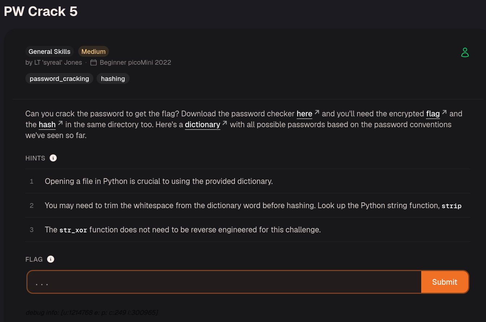
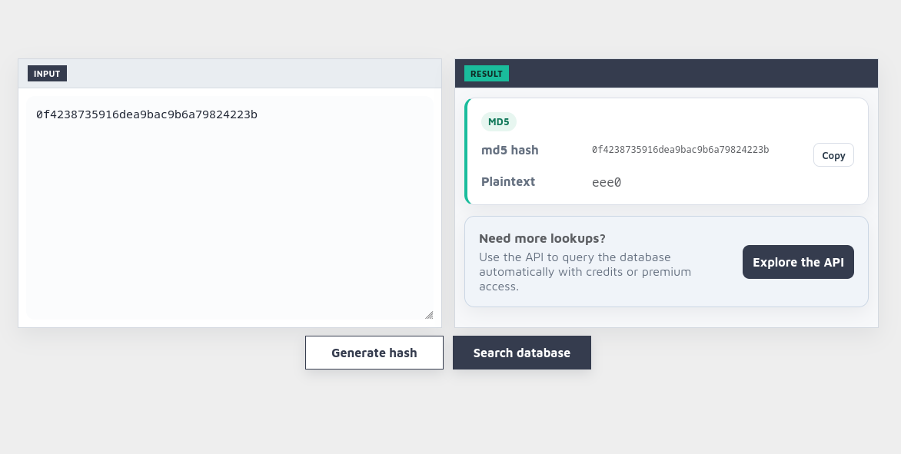
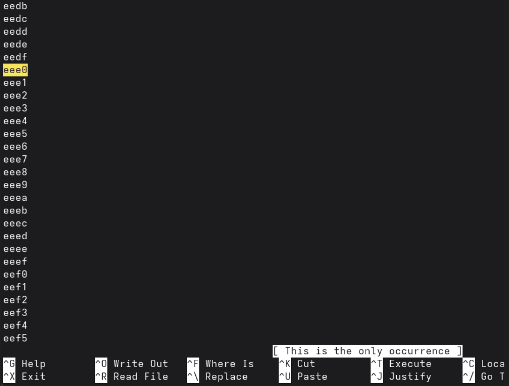

# PW Crack 5 — picoCTF Write-up

* **Platform:** picoCTF (Beginner picoMini 2022)
* **Category:** General Skills
* **Difficulty:** Medium
* **Author:** LT 'syreal' Jones



---

## 1. Challenge Overview
We are provided with four files:
* `level5.py` — a Python script that validates a user-supplied password against an MD5 hash and then decrypts the flag using an XOR cipher.
* `level5.flag.txt.enc` — the encrypted flag file.
* `level5.hash.bin` — a binary file containing the target MD5 hash of the correct password.
* `dictionary.txt` — a wordlist containing potential passwords.

---

## 2. Source Code Analysis
Inspecting `level5.py` reveals how the authentication and decryption mechanisms work:

```python
import hashlib

### THIS FUNCTION WILL NOT HELP YOU FIND THE FLAG --LT ########################
def str_xor(secret, key):
    #extend key to secret length
    new_key = key
    i = 0
    while len(new_key) < len(secret):
        new_key = new_key + key[i]
        i = (i + 1) % len(key)        
    return "".join([chr(ord(secret_c) ^ ord(new_key_c)) for (secret_c,new_key_c) in zip(secret,new_key)])
###############################################################################

flag_enc = open('level5.flag.txt.enc', 'rb').read()
correct_pw_hash = open('level5.hash.bin', 'rb').read()


def hash_pw(pw_str):
    pw_bytes = bytearray()
    pw_bytes.extend(pw_str.encode())
    m = hashlib.md5()
    m.update(pw_bytes)
    return m.digest()


def level_5_pw_check():
    user_pw = input("Please enter correct password for flag: ")
    user_pw_hash = hash_pw(user_pw)
    
    if( user_pw_hash == correct_pw_hash ):
        print("Welcome back... your flag, user:")
        decryption = str_xor(flag_enc.decode(), user_pw)
        print(decryption)
        return
    print("That password is incorrect")

level_5_pw_check()
```

The script hashes the input string using `hashlib.md5()` and compares the raw digest directly to the bytes stored in `level5.hash.bin`. Once matched, it passes the plaintext password as the key to `str_xor()` to reveal the flag.

---

## 3. Solution Walkthrough

### Step 1: Extract the MD5 Hash in Hex Format
Since `level5.hash.bin` stores raw binary bytes, we can run a quick Python one-liner in the terminal to convert its contents into a readable hexadecimal string:

```bash
python -c "print(open('level5.hash.bin', 'rb').read().hex())"
```

**Output:**
```text
0f4238735916dea9bac9b6a79824223b
```

### Step 2: Crack the MD5 Hash
Using an online MD5 hash lookup database (*md5decrypt.net*), we query the extracted hash `0f4238735916dea9bac9b6a79824223b` to find its plaintext equivalent:



* **Recovered Password:** `eee0`

### Step 3: Verify the Password in the Wordlist
To confirm that this password follows the challenge's conventions, we can inspect `dictionary.txt` using `nano` (and searching with `Ctrl + W` for `eee0`):



Indeed, `eee0` is present in the provided wordlist.

### Step 4: Retrieve the Flag
Finally, we execute `level5.py` and enter the cracked password `eee0`:

```bash
python level5.py
```

**Terminal Output:**
```text
Please enter correct password for flag: eee0
Welcome back... your flag, user:
academy{h45h_sl1ng1ng_27d64792}
```

---

## 4. Flag
```text
academy{h45h_sl1ng1ng_27d64792}
```